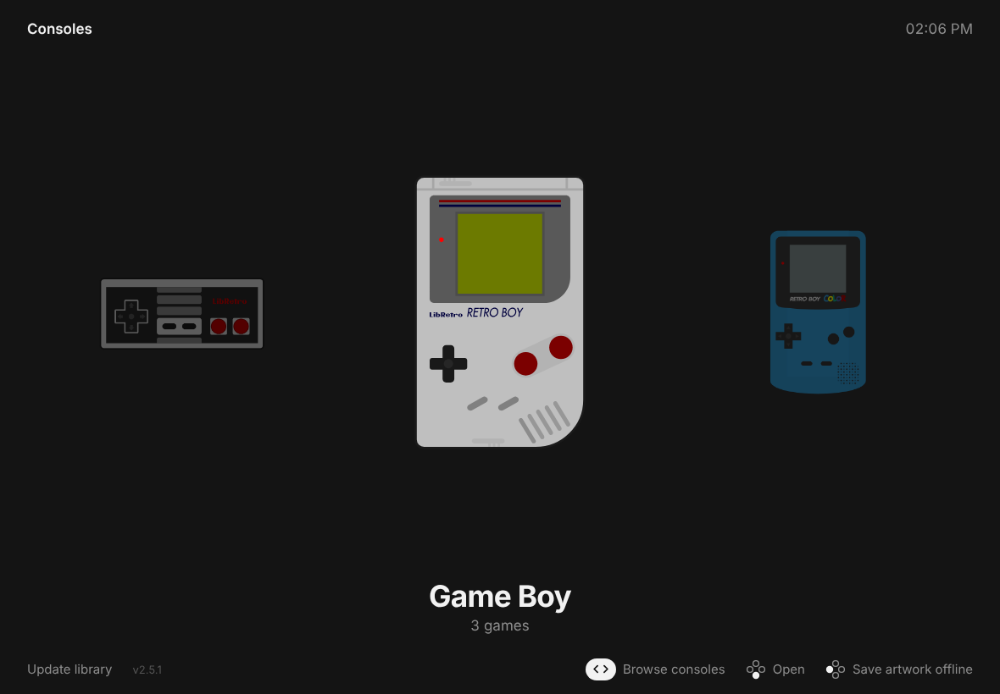
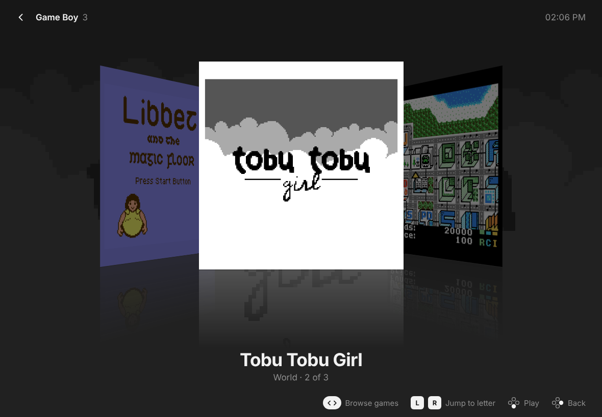

# Arcade Shelf

A controller-first launcher for RetroArch on iPad and iPhone. Pick a console, flick through your games as box art, press a button and RetroArch starts the game.

## Set up

1. Open the launcher's page in Safari, then **Share › Add to Home Screen**.
2. Open it from the Home Screen, tap **Choose playlists**, go to **On My iPad › RetroArch › playlists** and select all the `.lpl` files.
3. Optional: tap **Save artwork offline** so the box art is there without internet.

Tap **Update library** whenever you add games in RetroArch.

## Controls

| | Controller | Touch |
|---|---|---|
| Browse | D-pad / left stick | Swipe or flick |
| Open / play | Bottom face button | Tap the front item |
| Back | Right face button | ‹ in the top left |
| Jump to next letter | L / R (or up / down) | |
| Save artwork offline | Left face button | Button at the bottom |

## Come back here when you leave RetroArch

Use a Shortcuts automation so closing RetroArch drops you back in the launcher:

1. **Shortcuts › Automation › New Automation › App**.
2. Choose **RetroArch**, tick **Is Closed** only, and pick **Run Immediately**.
3. Add an **Open App** action and pick **Arcade Shelf**. If it isn't in the list (iOS doesn't always offer web apps there), use **Open URLs** with the launcher's address instead. That opens it in Safari rather than as the Home Screen app.

"Is Closed" fires when you leave RetroArch, for example by quitting a game and swiping home.

## Good to know

- Works offline once installed. Art you've looked at is kept, and **Save artwork offline** fetches the rest.
- Box art and screenshots come from the [libretro thumbnail server](https://thumbnails.libretro.com) and match on the game names in your playlists.
- New versions install themselves the next time you switch back to the app. To publish one, run `tools/bump-version.sh` before pushing.

## Credits

- System icons: RetroArch's Retrosystem theme from [libretro/retroarch-assets](https://github.com/libretro/retroarch-assets), CC BY 4.0. See `img/systems/CREDITS.md`.
- The screenshots show open-source homebrew, with each game's title screen standing in for box art: [Tobu Tobu Girl](https://github.com/SimonLarsen/tobutobugirl) (Tangram Games; MIT, art CC BY 4.0), [Libbet and the Magic Floor](https://github.com/pinobatch/libbet) (Damian Yerrick; zlib), [µCity](https://github.com/AntonioND/ucity) (Antonio Niño Díaz; GPL-3.0+).
